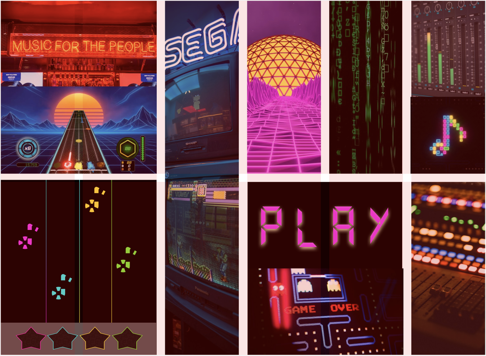
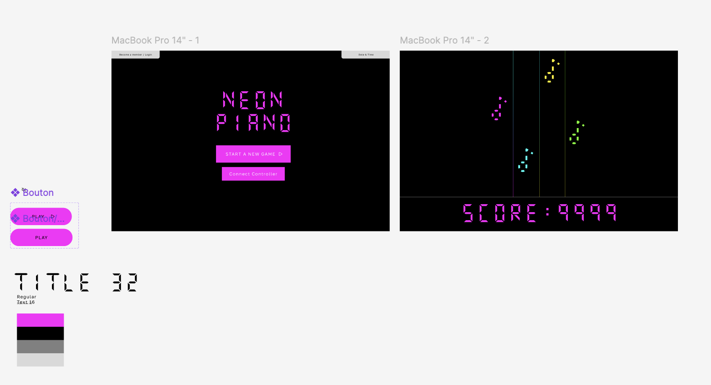
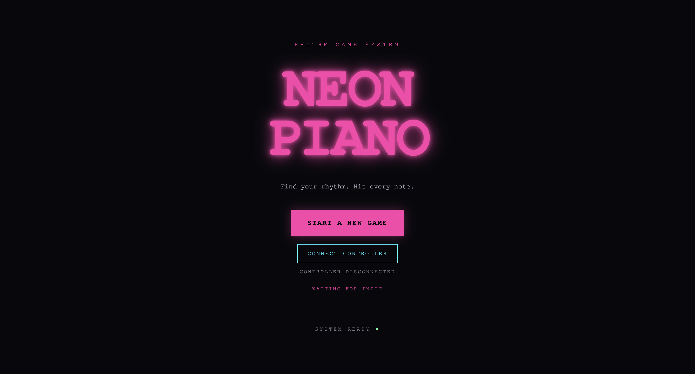
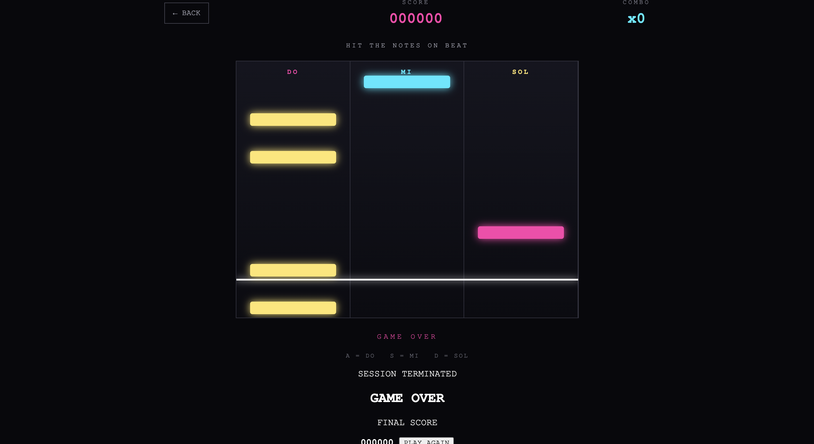
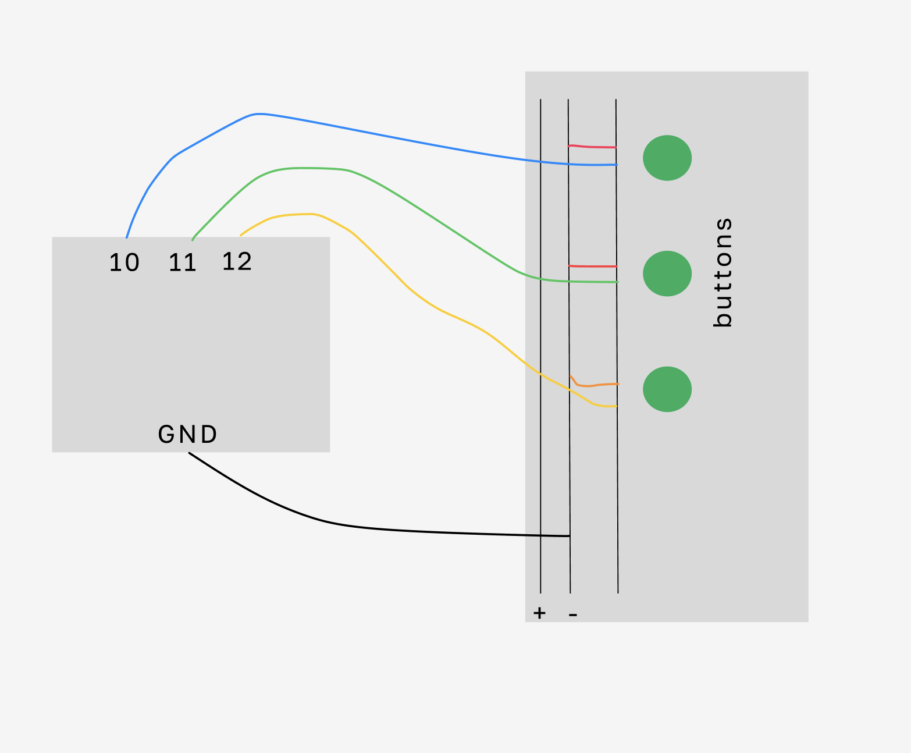

# NEON PIANO
## Project Documentation

## 1. Project Overview

NEON PIANO is an interactive rhythm game inspired by music video games such as Guitar Hero. Players must press three physical buttons at the right moment to reproduce musical sequences represented on screen by notes falling down three separate lanes.

The project combines a browser-based digital interface with a physical controller built using an Arduino UNO board, three push buttons and a passive buzzer.

The goal is to create a musical experience that is easy to understand but progressively requires greater precision and reaction speed. The game's visual identity is based on a retro-futuristic universe inspired by arcade games, synthwave and the electronic aesthetic of films such as TRON: Legacy.

## 2. Concept and Objectives

The concept is based on the interaction between three elements: the player, the physical controller and the digital interface.

Players watch the notes falling down three lanes. When a note approaches the hit line at the bottom of the screen, they must press the corresponding button on their controller.

Each button is associated with a musical note: DO, MI and SOL.

A successful hit increases the player's score and combo. However, if a note reaches the bottom of its lane without being played, the game immediately ends and the GAME OVER screen appears.

The main objectives of the project are:
- To design a physical controller capable of controlling a musical game.
- To develop an interactive interface accessible through a web browser.
- To connect physical interactions with digital events in real time.
- To create electronic sounds corresponding to the notes played.
- To provide an engaging experience based on scoring, rhythm and difficulty.

## 3. Art Direction and Visual Identity

### Moodboard

The moodboard helped define the visual universe of NEON PIANO. Several sources of inspiration were selected: arcade games and retro video games, music game interfaces such as Guitar Hero, synthwave and cyberpunk aesthetics, synthesizers and electronic music equipment, neon lighting effects, digital typography and LED displays.

The objective was to create an immersive atmosphere that evokes a technological and musical universe.

### Color Palette

The visual identity is mainly based on a black background combined with highly contrasting neon colors.

- Neon pink: the main interface color and the DO lane.
- Cyan: the MI lane.
- Yellow: the SOL lane.
- Black: the main background.
- White and grey: secondary text and navigation elements.

These colors make it possible to distinguish the three lanes immediately and improve readability during gameplay.

### Typography and Graphic Elements

The art direction uses digital-style typography and characters inspired by electronic displays. Titles are highlighted with glowing effects and neon shadows.

Graphic elements are intentionally simple: rectangular buttons, vertical lines, game lanes and score indicators. This simplicity helps maintain good readability during gameplay.

## 4. User Interface Design (UV1)

The first UV1 mockup helped define the main screens and user interactions.

### Home Screen

The home screen displays the NEON PIANO title in the centre of the page. Two main actions are available:

- START A NEW GAME: starts a new game.
- CONNECT CONTROLLER: connects the physical controller to the browser.

A status indicator also displays the controller's connection state.

### Gameplay Screen

The gameplay screen is organised around three vertical lanes, each corresponding to one musical note. Notes appear at the top of the lanes and gradually move towards a hit line located at the bottom of the screen.

The interface also displays the player's score, the combo, which increases when several notes are played successfully in a row, a message indicating the result of each hit and the available controls.

### GAME OVER Screen

When a note is not played in time, the game stops. A GAME OVER screen displays the final score and allows the player to restart without reloading the page.

## 5. Hardware Components

The project uses a physical controller built with an Arduino UNO, three push buttons, a passive buzzer, a breadboard, jumper wires and a USB cable.

The three buttons are connected to digital pins 10, 11 and 12 on the Arduino. The buzzer is connected to pin 9.

The buttons use the INPUT_PULLUP mode. This makes it possible to detect a press when the signal changes to LOW.

## 6. Technologies and Tools Used

### Arduino IDE and C++

Arduino IDE is used to program the Arduino UNO board. The program detects button presses and sends a message corresponding to each new press: DO, MI or SOL.

Communication takes place over USB at a baud rate of 9600. A new-press detection system prevents the same message from being sent continuously while a button is held down. The program also preserves the passive buzzer functionality.

### HTML, CSS and JavaScript

The game is developed as a web application using HTML, CSS and JavaScript.

- HTML defines the structure of the different screens and interface elements.
- CSS handles the layout, colours, visual effects and overall graphic identity.
- JavaScript manages the game logic, notes, score, interactions and controller communication.

The project is developed using Visual Studio Code and runs locally in Google Chrome through the Live Server extension.

### Web Serial API

Communication between the Arduino and the browser relies on the Web Serial API. This technology allows JavaScript to read information sent by a device connected through a USB serial port.

When the player clicks CONNECT CONTROLLER, Chrome displays a window allowing them to select the USB port. Once the connection is established, the browser receives messages from the Arduino and interprets them as game commands.

### Web Audio API

Game sounds are generated directly by the browser using the Web Audio API.

A sound synthesis system uses several oscillators, different frequencies and filters to create an electronic sound. The sound design aims to create a robotic and futuristic atmosphere consistent with the game's visual identity.

## 7. How the Game Works

The overall process relies on several successive steps:

1. The player presses a physical button.
2. The Arduino detects the new button press.
3. The board sends the corresponding message through USB.
4. The browser receives the message using the Web Serial API.
5. JavaScript identifies the corresponding note.
6. The game checks whether the note was played at the right moment.
7. The score, combo and visual feedback are updated.
8. The corresponding sound is generated by the browser.

The game system relies on a JavaScript animation loop that continuously updates the position of the notes.

Notes are generated from a predefined sequence and move downwards at a constant speed. The player has a limited timing window around the hit line to successfully play a note.

A successful hit awards 100 points and increases the combo. Missing a note immediately triggers the end of the game.

## 8. Developed Features

The following features have been implemented and tested:

- Home screen with a start button.
- USB connection to the physical controller.
- Serial port selection through Google Chrome.
- Detection of the three physical buttons.
- Communication between Arduino and the browser.
- Three gameplay lanes corresponding to the three notes.
- Note generation and movement.
- Predefined musical sequences.
- Hit detection and timing management.
- Score and combo system.
- Electronic sound generation in the browser.
- GAME OVER screen after a missed note.
- Ability to restart a game.

Keyboard controls are also available to test the game without using the physical controller.

## Final Result

The following screenshots show the final version of NEON PIANO, including the completed interface, gameplay and physical controller.

### Final Home Screen

### Gameplay

### Physical Controller

## 9. Challenges and Solutions

Several technical challenges were encountered during development.

**Communication between Arduino and the browser**

A serial communication system had to be implemented between the board and the browser. The Web Serial API made it possible to transmit button information directly to the web application.

**Interaction management**

Button detection needed to work with both the physical controller and the keyboard. A shared input-handling function was developed to centralise this logic.

**Timing management**

The game needed to determine whether the player pressed the correct button at the right moment. A system comparing the position of each note with the hit line was implemented.

**Sound design**

The initial sound was too simple and resembled an electronic beep. Several oscillators and filters were added to produce a richer, more metallic and robotic sound.

**JavaScript debugging**

Some errors occurred during successive code modifications, particularly because of duplicated function blocks. These errors were identified using the Chrome developer console and then corrected.

## 10. Future Improvements

The project now has a functional first version. Several improvements could be made:

- Add more songs and musical sequences.
- Develop several difficulty levels.
- Synchronise falling notes with actual background music.
- Improve sound effects and animations.
- Add a ranking system and save the best scores.
- Develop a song selection screen.
- Improve the interface to make it closer to the original mockup.
- Add settings to adjust volume and difficulty.